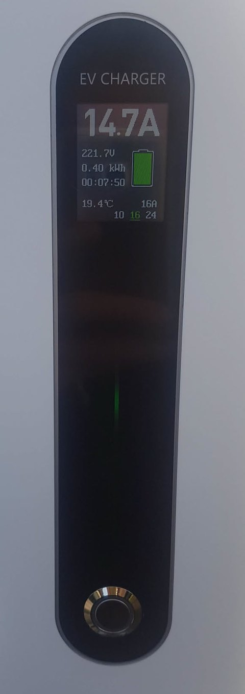
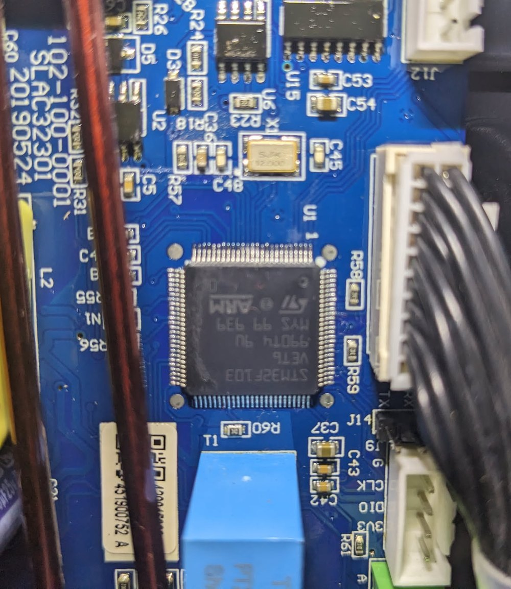
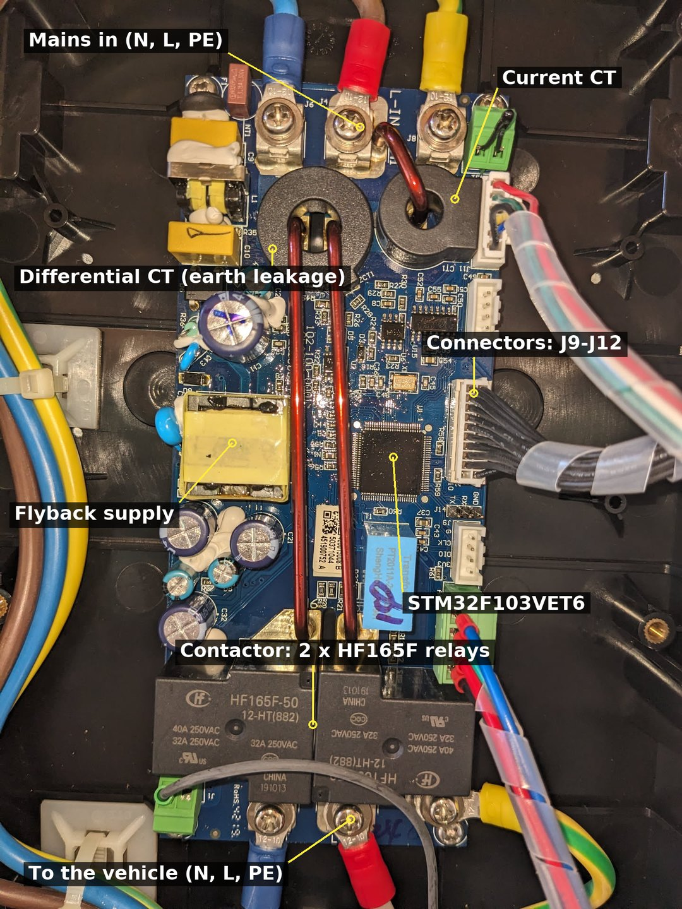
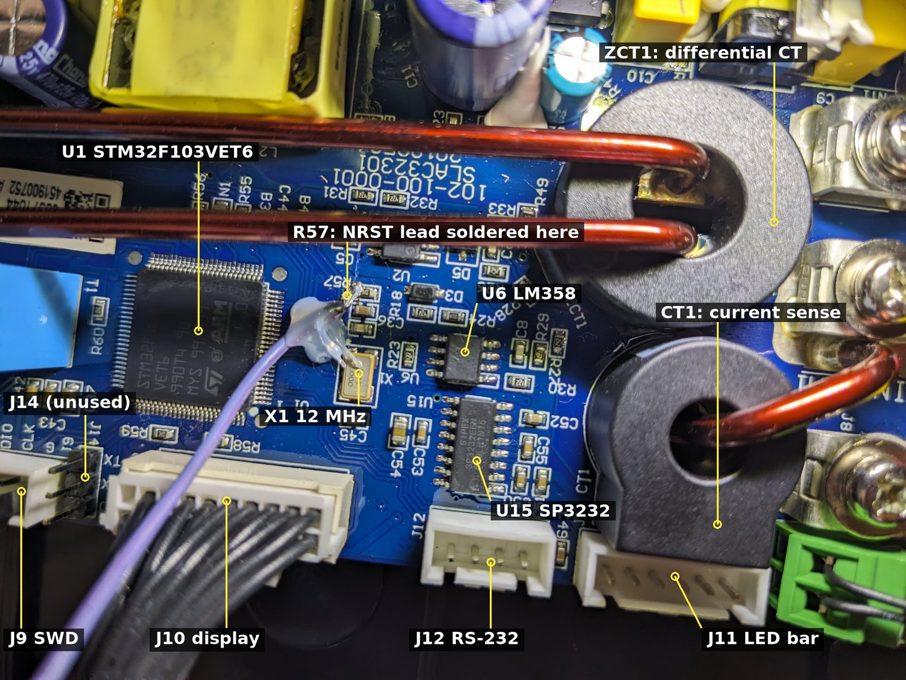
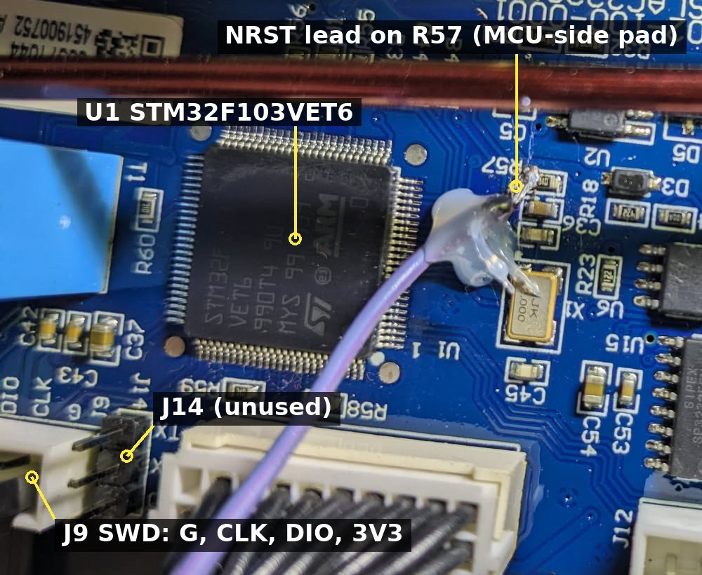
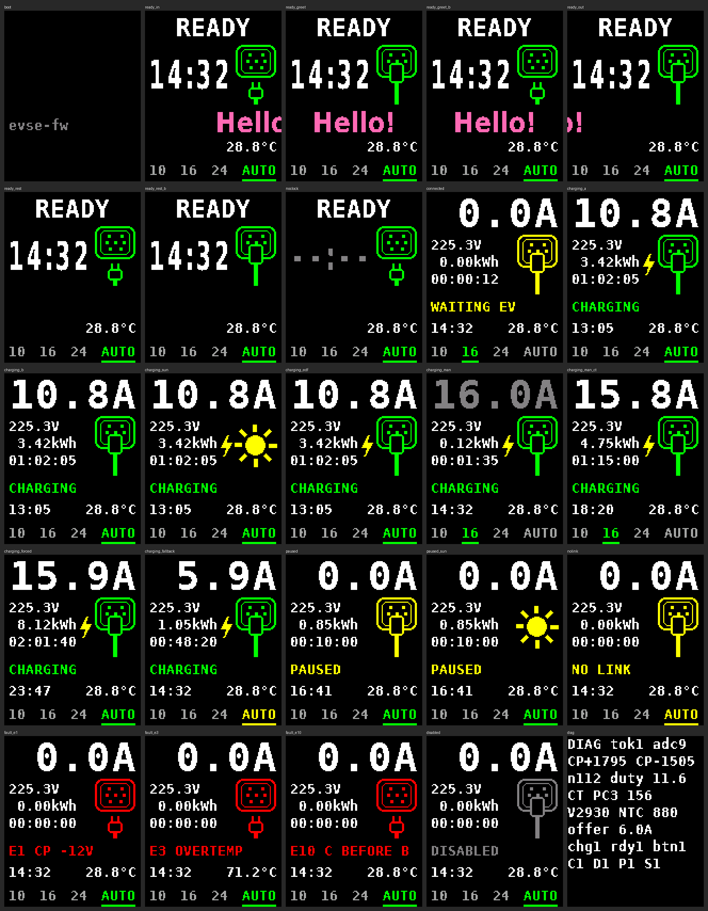

# IEVISON / Lefanev LE-F30: open EVSE firmware and hardware notes



**What we found inside a cheap single-phase EV charger built around an
STM32F103, how to unlock and flash it, and a firmware that adds a current
setpoint over its RS-232 port.**

The stock firmware only charges at the preset chosen with the front button
(10, 16 or 24 A), and it is read-protected. This project maps the board,
replaces the firmware and lets an energy manager (Home Assistant, a script...)
modulate the charging current, for instance to follow a solar surplus. The
safety logic is modelled on [OpenEVSE](https://github.com/OpenEVSE/open_evse).

> **Use at your own risk.** This is mains-voltage equipment that charges a
> vehicle: a mistake can cause a fire or an electric shock. Flashing it
> erases the stock firmware for good. This project is not affiliated with
> IEVISON, Lefanev or the board's maker, and it has been tested on one
> station only.

<br clear="right">

## Does this match your charger?

These boards are sold under several brands. Yours may be the same one under
another logo if most of this matches:

- **Brands seen:** IEVISON, **Lefanev LE-F30**.
- **Front:** a 1.8" colour screen, a vertical LED bar, one push button that
  cycles **10 / 16 / 24 A** (shown at the bottom of the screen, the active one
  in green). Single phase, tethered Type 2 cable.
- **Stock screen:** "EV Charger" at boot, then the big current on top,
  voltage / energy / elapsed time on the left, a socket-and-plug or battery
  picture on the right, temperature and the preset row at the bottom. The
  version string looks like `J:4.2444.112AC07`.
- **Main board:** silkscreen `102-100-0001` / `SLAC32301`, an
  **STM32F103VET6** (U1) with a 12 MHz crystal, an **SP3232** RS-232
  transceiver (U15), an **LM358** (U6), an **FM2147** earth-leakage detector
  (U2), two **Hongfa HF165F-50** relays, two current transformers.
- **Display:** Topway **LMT018DNBFWD-1** (ILI9163C, 128x160, 8-bit parallel).
- **LED board:** `102-001-0175` / `SLAC32301-A12`, a 74HC595.



## Safety

- **Earth leakage stays in hardware.** A differential current transformer
  (ZCT1) drives the FM2147 (U2), which fires an SCR and trips the supply on
  its own, whatever the microcontroller does. The firmware does not touch it.
  The spec sheet announces "type A + 6 mA DC": we found the 30 mA detector
  but did not identify any 6 mA DC detection (the back of the board was not
  inspected). Install the protection your wiring rules require upstream.
- **No diode check on this board.** No input sees the negative half of the
  Control Pilot line, so a vehicle cannot be told from a resistive CP-PE leak
  (water in the plug...). The firmware checks the state sequence instead: see
  [Known limitations](#known-limitations).
- **Flashing is irreversible.** The stock firmware is read-protected; removing
  the protection mass-erases the chip. There is no way back to stock.
- **Work with the station unpowered**, the upstream breaker open, and keep that
  breaker as your cut-off during the first tests. Never let the ST-Link supply
  the board (its 3.3 V output stays unconnected).

## Inside the station



Mains comes in at the top (N, L, PE). L and N pass through the differential CT
(ZCT1), L also through the current transformer (CT1), then through the two
relays that form the contactor, and leave at the bottom towards the vehicle. A
discrete flyback supply on the left makes the 12 V rail (relay coils, Control
Pilot stage) and the 3.3 V logic. The low-voltage side is isolated from the
mains: its ground is the CP / PE reference.



### Pin map

MCU: **STM32F103VET6**, 12 MHz crystal. `[OK]` measured and used,
`[?]` read correctly but not fully confirmed.

| Function | Pin | Notes |
|---|---|---|
| Control Pilot, drive | **PA7** = TIM3_CH2 | 1 kHz hardware PWM, high = +12 V. Never leave it floating: the CP stage then drifts with any disturbance |
| Control Pilot, sense | **PC1** (ADC1_IN11) | positive half of the CP line: +12 / +9 / +6 V read ~3670 / ~2710 / ~1800, clamped at 0 below 0 V |
| CP output stage | **PC5** (ADC1_IN15) | the stage BEFORE the 1 kOhm: +12 V ~2300, -12 V ~1475. Proves that the -12 V half is generated, blind to the vehicle |
| Contactor (both relays) | **PB1** | active high |
| Button | **PE14** | active low |
| Current | **PC3** (ADC1_IN13) | CT1 -> LM358 (U6): half-wave rectified 50 Hz; the mean over 20 ms follows the current (0.0384 A per count here) |
| Mains voltage | **PA2** (ADC1_IN2) `[?]` | half-wave rectified 50 Hz, peak ~2920 counts at ~230 V |
| Mains 50 Hz | PC0 `[?]` | a 50 Hz square wave (zero-cross detector?), not used |
| Temperature | **PC2** (ADC1_IN12) | NTC; the reading FALLS when hot (~3225 at room temperature) |
| Display | FSMC, bank 1 / NE1 | D0-D7 = PD14 PD15 PD0 PD1 PE7 PE8 PE9 PE10, CS = PD7, RD = PD4, WR = PD5, D/C = PD13 (FSMC A18), /RES = PD11 (plain GPIO); backlight hard-wired on |
| LED bar (74HC595) | **PE4** data, **PE3** clock, **PE2** latch, **PE5** red enable | see below |
| RS-232 (J12) | **PA9** TX / **PA10** RX = USART1 | through the SP3232 (U15) channel 1 |
| SWD (J9) | PA13 / PA14 | NRST only on the pad of R57 |
| Earth leakage | FM2147 (U2) + SCR | autonomous hardware, not connected to the MCU |

[`src/board.h`](src/board.h) is the commented reference, with every threshold.

### Connectors

| | Pins | Notes |
|---|---|---|
| **J9** SWD | G · CLK · DIO · 3V3 (silkscreen) | DIO = PA13 (SWDIO), CLK = PA14 (SWCLK). No reset pin: see [Flashing](#unlocking-and-flashing) |
| **J10** display | 2x10, latched | numbered like a DIP: the latch-side row 1 (J14 end) to 10 (J12 end), the other row 11 (J12 end) to 20 (J14 end). Pin n = the display ribbon's pin n: 1 BLK, 2 BLA, 3 VSS, 4 VDD, 5-6 NC, 7 /CS, 8 /RES, 9 D/C, 10 /WR, 11 /RD, 12-19 DB7..DB0, 20 VSS |
| **J11** LED bar | 6 wires | green = PE5 (enables the red LEDs, through a transistor), white = PE4 (SER), yellow = PE3 (SRCLK), blue = PE2 (RCLK), black = 3.3 V, red = GND |
| **J12** RS-232 | 1 GND · 2 TX · 3 RX · 4 +12 V | real RS-232 levels (±5.5 V). Our network bridge plugs in here |
| **J14** | RX · TX · GND | not connected to the MCU, unused |

UART4 (PC10/PC11) only reaches the SP3232's second channel, which does not go to
J12: the serial port to use is USART1.

### LED bar

Eight bicolour positions behind the front window, driven by the 74HC595 on the
LED board: output k is position k from the top. Per output, 0 lights GREEN,
1 lights RED while PE5 is high, else the position is dark. So a dark bar is
all ones with PE5 low, and red can only be shown with every other position red
or green. Left floating, PE2-PE5 let the bar light at random: drive them.

### Control Pilot

The CP output follows PA7 (high = +12 V, low = -12 V), through the usual 1 kOhm.
PC1 reads the line's positive half with a fine scale; PC5 reads the output
stage before the resistor. Plateaus on PC1, measured on a vehicle (ADC counts):

| State | Line | PC1 |
|---|---|---|
| A, nothing plugged | +12 V | ~3680 |
| B, vehicle connected | +9 V | ~2711 (~2683 under a 10 % PWM) |
| C, vehicle ready | +6 V | ~1795 |
| D, ventilation | +3 V | ~880 (estimated, not measured) |

The firmware decides at the mid-points (3195 / 2240 / 1340). Read the CP in
bursts over one full period and keep the plateau, not single samples (see
`cp_burst()` in [`src/main.cpp`](src/main.cpp)).

## Unlocking and flashing

You need an **ST-Link V2** (a clone is fine), four wires and
[PlatformIO](https://platformio.org/).



- **J9** carries SWDIO, SWCLK and GND. The stock firmware turns the SWD pins
  into GPIOs at boot, so the first connection has to be made **under reset**,
  and NRST is not on J9: solder a thin flying lead on the MCU-side pad of
  **R57** (the NRST pull-up, photo above), insulate it, and wire it
  to the probe's RST pin.
- Many ST-Link V2 clones do not drive their RST pin for STM32 targets: check
  with a meter that NRST goes to 0 V when the connection starts, or hold the
  lead to GND by hand.
- **Removing the read protection** (RDP level 1 -> 0) mass-erases the chip:
  the stock firmware is gone for good. Power-cycle afterwards and check the
  option bytes: RDP level 0, no write protection, software watchdog.
- Flash the `diag` build first, calibrate (below), then the `evse` build.

The OpenOCD configuration and the exact commands are in
[`tools/openocd/README.md`](tools/openocd/README.md). Once this firmware runs,
the SWD port stays enabled: later updates need no NRST lead.

**Without the probe:** the STM32's ROM bootloader listens on USART1, i.e. on
J12. The firmware's `BOOTLOADER` command (accepted only with no vehicle and the
contactor open) reboots into it, and
[`tools/stm32_bridge_flash.py`](tools/stm32_bridge_flash.py) writes the new
image through the network bridge, every block read back.
[`tools/flash-over-bridge.sh`](tools/flash-over-bridge.sh) does the whole
sequence over MQTT.

## A basic firmware: what it takes

Everything below is implemented in [`src/`](src) and can be reused piece by
piece (PlatformIO, STM32duino, board `genericSTM32F103VE`).

- **Clock:** the crystal is 12 MHz, not 8: build with `-D HSE_VALUE=12000000U`
  and configure the PLL x6 for 72 MHz; set the ADC prescaler to /6 (12 MHz),
  STM32duino does not when you replace `SystemClock_Config()`.
- **CP drive:** TIM3_CH2 on PA7 (pin name `PA_7_ALT1`: plain `PA7` maps to
  TIM1_CH1N first), 1 kHz, PWM mode 1, prescaler set explicitly to 1 us per
  tick (`setOverflow(1000, MICROSEC_FORMAT)` picks a wrong one). Duty in % =
  amps / 0.6; 100 % = steady +12 V = no offer. Drive PA7 high before anything
  else at boot.
- **ADC:** never use `analogRead()`: it re-initialises and re-calibrates the
  ADC on every call (~100 us) and that activity alone disturbs the CP stage.
  Drive ADC1 directly (one calibration, then single conversions of a few us).
- **CP state:** read bursts over a period, rank-filter the plateau, debounce
  (250 ms; 25 ms to A; 50 ms to leave C). Enter C only with the PWM on, the
  -12 V half present on PC5, the measured duty close to the commanded one, and
  the B plateau seen first. D and E are faults.
- **Contactor:** PB1 high closes both relays. To stop, withdraw the PWM first
  (+12 V), let the vehicle open S2, then open the relays (after 3 s at most).
  Do not re-close within 60 s of an opening.
- **Measurements:** current = mean of PC3 over 20 ms above its zero; mains =
  peak of PA2 over 20 ms; temperature = PC2, mirrored (it falls when hot).
- **Safety net:** open the contactor and set the CP to +12 V first thing at
  boot; independent watchdog (2 s); latch faults for a minute.
- **Display:** FSMC bank 1, 8-bit, command register at 0x60000000, data
  register at 0x60040000 (D/C on A18); ILI9163C initialisation, MADCTL 0xC8.
  [`src/display.cpp`](src/display.cpp) has the sequence and a small UI.

## This firmware

- **Charging:** IEC 61851 state machine, current from 6 to 24 A, sequence
  check in place of the diode check, over-temperature throttle and cut,
  over-current and welded-contact detection, session energy.
- **Front panel:** the stock layout plus an AUTO preset, fault codes and the
  time of day; a READY screen with a big clock, the animated plug and a
  greeting; the LED bar animates with the current. The button cycles
  10 -> 16 -> 24 -> AUTO.
- **Serial port (J12, 115200 8N1, one ASCII line per command):** `SET <amps>`,
  `MODE AUTO|MAN`, `PRESET 10|16|24|AUTO`, `ENABLE 1|0`, `TIME HH:MM[:SS]`,
  `INFO EDF 1|0` (supply on the grid / off-grid: the screen then shows a sun),
  `VERSION`,
  `BOOTLOADER`. Once a second the station answers
  `STATE=<A|B|C|F> ERR=<n> OFFER=<a> AMP=<a> VOLT=<v> TEMP=<t> NTC=<raw> ENERGY=<kWh> TMIN=<min> EN=<0|1> MODE=<AUTO|MAN> SEL=<10|16|24|AUTO>`.
  In AUTO, without a setpoint for 30 s, it falls back to 6 A on its own.
- **Diagnostic build** (`pio run -e diag`): raw readings on the serial port and
  the screen, `OFFER`, `CHARGE ON/OFF` behind an interlock, `SCAN`, `CTPIN`,
  `CAP` (details at the top of the diag section of `main.cpp`).



Build with `pio run -e evse` (or `-e diag`). The greeting of the READY screen
is "Hello!"; to show your own without touching the repository:
`python3 tools/fonts/gen_fonts.py <DejaVuSansMono-Bold.ttf> --local --greeting "..."`
writes `src/greeting_local.h`, which git ignores.

**Without the hardware:** [`tools/sim`](tools/sim) compiles `main.cpp`
unchanged against a mocked HAL and a simulated vehicle, replays charging
scenarios, renders every screen, and runs the firmware live in a browser page:
`tools/sim/build.sh && tools/sim/live.py`.

## The network bridge

WiFi does not work from inside the closed box (the station hangs on an outside
wall), so the bridge lives indoors and reaches J12 through a short cable: an **ESP8266** (NodeMCU or
D1 mini) running [ESPHome](https://esphome.io/), relaying MQTT to the serial
port and back. It carries no charging logic. The transmit side drives the
station's SP3232 input directly with an inverted 3.3 V output; the receive side
goes through the receiver half of a MAX3232 module. Wiring, configuration and
MQTT topics: [`esp-bridge/README.md`](esp-bridge/README.md).

For the energy manager, follow OpenEVSE's "divert" logic: smooth the available
current (20 s when it rises, 600 s when it falls), start at 6.5 A, pause below
6 A only after 10 minutes of charge, and re-send the setpoint periodically.

## Calibration

The CP thresholds, the current scale and the temperature curve were measured on
one station; check them on yours with the `diag` build (serial port at 115200,
through the bridge or any RS-232 adapter on J12).

1. **CP at rest**, no vehicle: the CP reads +12 V against PE; `cp_pos` gives
   the A level.
2. **`OFFER 10`:** a DC meter on the CP averages about -8 V and `duty` reads
   ~16.7. +8 V or a duty of ~83 means an inverted stage: stop.
3. **Vehicle plugged** (or a CP simulator: 2.74 kOhm + diode = B,
   882 Ohm + diode = C): note the B and C plateaus, set `CP_POS_AB / BC / CD` in
   `board.h` half-way between them, re-flash.
4. **`CHARGE ON`** with the vehicle ready: the contactor closes only while the
   interlock holds. Read `ct` (the 20 ms mean on PC3) at known currents to set
   `CT_ZERO_COUNT` and `CT_A_PER_COUNT`, and the NTC at a known temperature.
5. Put the values in `board.h`, then flash the `evse` build.

## Known limitations

- **No diode check** (see Safety). The firmware accepts C only after the B
  plateau has been seen since the vehicle was plugged: a real vehicle shows B
  before it closes S2, a leak sitting in the C window never does (`ERR=10`,
  retried every 10 s). Still not detected: a vehicle without its diode, or a
  leak that starts in the B window and drifts into C.
- The mains voltage scale (`V_PER_COUNT`) is provisional; the NTC curve rests
  on one point with an assumed Beta; the D plateau was not measured.
- Tested on one station, with two vehicles.

## Repository

```
platformio.ini      builds: evse (normal), diag (calibration), ledprobe (pin finder)
src/                the firmware: board.h (pin map, thresholds), main.cpp, display.cpp, ui_assets.h
esp-bridge/         ESPHome configuration of the network bridge + its flash-mode component
tools/openocd/      OpenOCD configuration and the unlock / flash procedure
tools/sim/          host simulation bench, screenshots, live simulator
tools/fonts/        generator of ui_assets.h (fonts, icons, greeting)
tools/flash-over-bridge.sh, tools/stm32_bridge_flash.py
                    firmware update through the network bridge
docs/               photos, UI preview
```

## License

Copyright (C) 2026 sebcorse. This program is free software: you can
redistribute it and/or modify it under the terms of the GNU General Public
License as published by the Free Software Foundation, either version 3 of the
License, or (at your option) any later version. See [`LICENSE`](LICENSE).

The fonts in `src/ui_assets.h` are rendered from DejaVu (Bitstream Vera
licence). The safety logic follows OpenEVSE's design.
